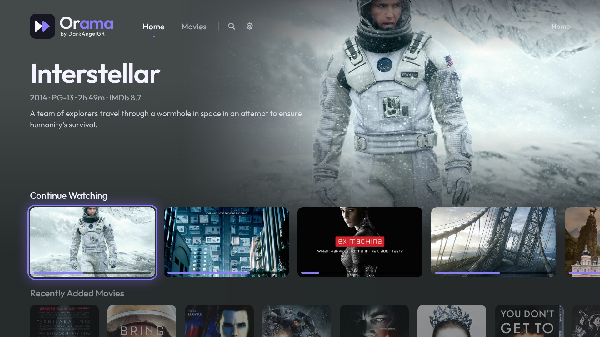
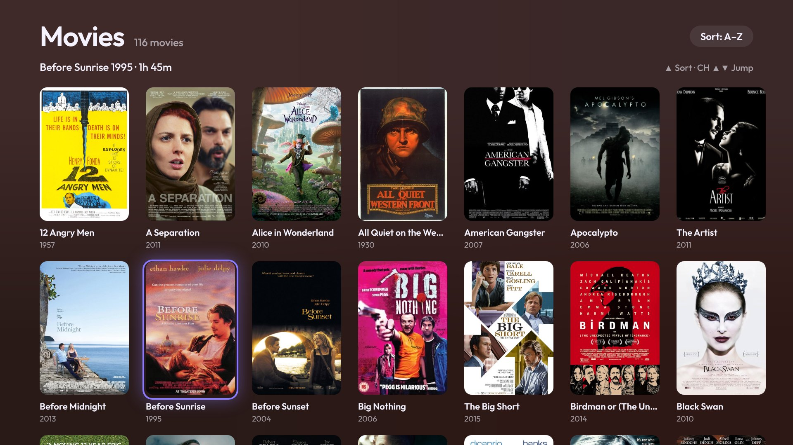

<p align="center">
  <picture>
    <source media="(prefers-color-scheme: light)" srcset="assets/brand/lockup-horizontal-dark-1920x640.png">
    
  </picture>
</p>

<h3 align="center">The fast, good-looking way to watch Plex and Jellyfin on a Samsung TV.</h3>

<p align="center">
  Opens in a second. Plays almost everything straight through the TV's hardware decoder.<br>
  Has the extras the official apps never got around to.
</p>

<p align="center">
  <a href="https://github.com/DarkAngelGR/orama/releases/latest"></a>
  
  
  <a href="LICENSE"></a>
</p>

<p align="center">
  <a href="#install">Install</a> ·
  <a href="#features">Features</a> ·
  <a href="#using-the-remote">Remote</a> ·
  <a href="#plex-or-jellyfin">Plex or Jellyfin</a> ·
  <a href="#optional-companions">Companions</a> ·
  <a href="#for-developers">Developers</a>
</p>

<p align="center">
  
</p>
<p align="center">
  
  
</p>

---

**Orama** (όραμα, Greek for *vision*) replaces the official Plex app on Samsung smart TVs, and
speaks Jellyfin too. The official app can take up to a minute to open and lags on every key
press. Orama opens in about a second, scrolls smoothly, and lets the TV's own decoder do the
work, so your server barely notices you're watching.

## Install

You need a Samsung smart TV running Tizen 6.5 or newer (2022 models onward) and a Plex Media Server or
a Jellyfin server (10.8 or newer).

### Easiest: a release and Apps2Samsung

1. Download `Orama-x.y.z.wgt` from the **[latest release](https://github.com/DarkAngelGR/orama/releases/latest)**.
2. Turn on [Developer Mode](#developer-mode) on the TV.
3. Open [Apps2Samsung](https://github.com/Apps2Samsung/Apps2Samsung) (Windows, macOS or Linux),
   pick your TV and install the `.wgt`.
4. Open Orama, go to **[plex.tv/link](https://plex.tv/link)** on your phone and enter the code, or
   scan the QR code. Using Jellyfin? See [Signing in with Jellyfin](#signing-in-with-jellyfin).

Once it's installed, the optional [Orama installer](installer/) keeps it up to date from the TV.

### From source (macOS or Linux)

```sh
git clone https://github.com/DarkAngelGR/orama.git
cd orama
./scripts/setup.sh     # Samsung's command-line tools, finds the TV, creates a signing certificate
./scripts/deploy.sh    # builds, installs and opens Orama on the TV
```

`setup.sh` explains what to do if Developer Mode isn't on yet, and picks up where it left off
when you run it again.

<a id="developer-mode"></a>
<details>
<summary><b>Turning on Developer Mode</b></summary>

1. Press **Home** on the remote and open **Apps**.
2. On the Apps screen, type **1 2 3 4 5**. No number keys? Use the on-screen keypad (**123**).
3. Switch **Developer mode** to **On** and enter the IP address of the computer (or server) that
   will install apps.
4. Choose **OK**, then restart the TV: hold **Power** until it turns off and on again.

The Apps screen shows **Develop mode** at the top when it's on.
</details>

<details>
<summary><b>Troubleshooting</b></summary>

| Problem | Fix |
| --- | --- |
| Typing 12345 does nothing | Make sure you're on the **Apps** screen, and type quickly. |
| The TV isn't found | Turn it on and check it's on the same network as your computer. |
| "Can't reach the TV" when installing | Developer Mode must point at the installing machine's IP. Re-enter it and restart the TV. |
| The app disappeared | Firmware updates can remove sideloaded apps; install it again. |
| The sign-in code expired | Press **OK** on the sign-in screen for a new one. |
</details>

## Features

### ⚡ Fast
- **Home in under a second**, smooth scrolling everywhere, search results as you type.
- **Direct play** through Samsung's hardware decoder. Only what the TV really can't play is
  converted, and the player says exactly what's happening: *Direct Play*, *Direct Stream* or
  *Transcoding*.
- A file the TV once refused is remembered, so next time it's converted straight away instead of
  failing first.
- Audio the TV can't play (like DTS) is swapped for another track in the same language when the
  file has one, so nothing needs converting.

### 🎬 Made for watching
- **Pick before you play:** version, quality, audio and subtitles, or make Greek or English
  subtitles the default for everything.
- **Clear versions.** When a title has several files, each one is named for what it is, e.g.
  *Final Cut · 4K Dolby Vision* with *HEVC · TrueHD Atmos 7.1 · 58 GB* underneath. The player
  shows which one is on, you can switch mid-film, and Resume picks up the same file.
- **Skip intro and credits**, up next with your languages kept, and every show remembers the
  audio and subtitle languages you picked for it.
- **Subtitles your way:** timing, size (up to Huge) and colour (white, greys, yellow).
- **Seek with pictures** (when Plex makes them: Settings › Library › *Generate video preview
  thumbnails*), ⏪ ⏩ to jump 30 seconds, and the previous or next episode one press away.
- **HDR-aware:** subtitles and controls dim slightly so white text doesn't glare.
- **Anime-aware:** Japanese audio with Greek (else English) subtitles, the full dialogue track
  rather than "Signs & Songs", and translated signs at the top of the screen.
- **Rich pages:** IMDb, Rotten Tomatoes and TMDB ratings, cast with photos, trailers and an *Extras* row (behind the scenes, deleted scenes, featurettes), the rest of
  a collection, episode descriptions, theme music and a full *More info* page.
- **Continue Watching that tells you things:** "S3 · E4 · 18m left". Hold OK to remove a tile,
  mark it watched or clear its progress.
- Each library remembers its sort and its all / unwatched filter, per profile.

### 🗄️ Made for your server
- **Smart search:** type what you're in the mood for, like *80s horror*, *unwatched comedies
  under 2 hours*, *best sci-fi shows* or *Keanu Reeves movies*, and get a row of matches from your
  library. Genres, decades, length, watched state and people; no AI involved.
- **Discover rows** on Home (with watchlist-sync): *Trending this week* and *Recommended for you*,
  only titles you don't have yet, each one press of OK away from being requested.
- **Search beyond your library:** find any movie or show and add it to your Plex Watchlist, or on
  Jellyfin, **Request** it straight into Sonarr/Radarr (with watchlist-sync).
- With [watchlist-sync](#optional-companions), Watchlist adds reach Sonarr and Radarr in seconds,
  and a *Downloading* row shows their progress live.
- Library scans show up on the home screen as they happen, and new media appears by itself.
- **Delete** a movie or show from its page (server owner only). With watchlist-sync it's removed
  from Radarr or Sonarr too, so it won't come back.
- With watchlist-sync and Bazarr: search for more subtitles from the TV, and a *Coming up* row
  shows episodes airing this week.

### 🏠 Made for the household
- Plex Home profiles with PINs, and an optional *Who's watching?* at start.
- **Watch Together** (Plex): press *Watch together* on a title, pick a Plex friend, and you both
  watch in sync, even if they're on Plex Web on a PC. Whoever pauses, plays or skips moves
  everyone. Invitations show up as a row at the top of Home. Uses Plex's own Watch Together
  service, which Plex keeps for its web app; based on the protocol notes in
  [plex-for-kodi](https://github.com/pannal/plex-for-kodi/pull/300).
- Updates from GitHub Releases, installed from the TV itself with the optional
  [Orama installer](installer/).

## Using the remote

| Remote | What it does |
| --- | --- |
| Arrows / OK | Move around / select |
| Hold OK on a home tile | Remove from Continue Watching, mark watched / unwatched |
| Play/Pause | Play whatever is focused; pause and resume |
| Back | Go back (while watching, the first press hides the controls) |
| ▲ while watching | Info bar: title, version, progress and how it's playing |
| ▼ while watching | Audio, subtitles, version and quality, previous / next episode |
| ◀ ▶ while watching | Seek 10 s; hold to go faster |
| ⏪ ⏩ while watching | Jump 30 s; hold to go faster |
| ⏮ ⏭ while watching | Previous / next episode (on remotes that have them) |
| CH ▲ / CH ▼ while watching | Subtitles on or off |
| ▲ from a library's first row | Sort (A–Z, recently added, release date, rating) and show all / unwatched |
| CH ▲ / CH ▼ in a library | Jump by letter |

Everything else lives in **Settings**: profiles, default quality, subtitle language and style,
audio formats your TV can play, force direct play, theme music, downloads and updates.

## Plex or Jellyfin

Orama looks and works the same with either server.

### Signing in with Jellyfin

On the sign-in screen, press **Down** and pick **Use a Jellyfin server instead**, then type your
server's address (for example `192.168.1.10`; port 8096 is added for you).

- **Quick Connect** on (Jellyfin › Dashboard › General): the TV shows a code. On your phone, open
  Jellyfin, go to your profile › **Quick Connect** and enter it.
- **Otherwise**, or if you press OK, sign in with your user name and password.

To switch back to Plex, use **Settings › Sign out**.

### What each server supports

| | Plex | Jellyfin |
|---|:---:|:---:|
| Home, libraries, search, resume, watched state | ✓ | ✓ |
| Direct play, converting only what the TV can't play | ✓ | ✓ |
| Subtitles (text drawn by Orama, pictures burned in) | ✓ | ✓ |
| Several versions of a title, clearly named | ✓ | ✓ |
| Skip intro / credits | ✓ | ✓ ¹ |
| Theme music, trailers, extras, cast, delete | ✓ | ✓ ² |
| watchlist-sync extras (downloads, collections, Bazarr subtitles) | ✓ | ✓ |
| Search outside your library and get it | ✓ Watchlist | ✓ Request ⁴ |
| Smart search, Discover rows | ✓ | ✓ |
| Watch Together | ✓ | – |
| Home profiles with PINs | ✓ | – ³ |
| Preview pictures while seeking | ✓ | ✓ ⁵ |

¹ With media segments (Jellyfin 10.10+, e.g. the Intro Skipper plugin).
² Deleting needs an administrator.
³ Sign out to change user.
⁴ Through watchlist-sync 1.3+, which searches Sonarr/Radarr and adds the title there.
⁵ From Jellyfin's trickplay images (Jellyfin 10.9+, turned on per library).

## Optional companions

Orama works on its own. Two small Docker services on your server add more, and they're found
automatically when they run on the same machine as Plex or Jellyfin.

| | |
| --- | --- |
| **[watchlist-sync](https://github.com/DarkAngelGR/watchlist-sync)** | Sends your household's and friends' Plex Watchlists to Sonarr and Radarr. Orama then syncs Watchlist adds instantly, shows download progress and upcoming episodes, lists the parts of a collection you're missing, searches Bazarr for subtitles, and removes deleted titles from Sonarr / Radarr. |
| **[Orama installer](installer/)** | Keeps Orama up to date: when a release is out, install it from **Settings › Updates** on the TV or from a web page on your phone. |

## Why it's fast

Samsung TVs only run web apps, but their web engine is quick if you treat it like a game engine:

- every animation is a GPU transform or fade, short, and skipped while a key is held (or all of
  them, with Settings › Animations off);
- lists recycle a fixed set of tiles;
- the focus ring stays still while content slides under it;
- a held key never queues up work;
- the server resizes every image to exactly the pixels on screen.

The biggest single win was the background: a full-screen CSS gradient took almost two seconds
to repaint on the TV's CPU, so it was replaced with a 2×2-pixel WebGL texture that the GPU
stretches for free.

<details>
<summary><b>Measurements</b> (2022 Samsung Q60B, Tizen 6.5)</summary>

| | Official Plex app | Orama |
| --- | --- | --- |
| Opening the app | about a minute | about a second |
| Typing in search | every letter lags | instant |
| Scrolling | stutters | about 50 fps, 17 ms median frame |

| Background renderer | fps while navigating | worst frame |
| --- | --- | --- |
| Full-screen CSS `radial-gradient` | 11 | 1,928 ms |
| 2×2 2D canvas, stretched by CSS | 20 | 207 ms |
| 2×2 WebGL canvas, stretched by the compositor | 49–50 | 80 ms |

On a real 3,952-item library, 98.7% of titles play without any transcoding.
**Settings › Performance overlay** shows the frame rate on your own TV.
</details>

## For developers

<details>
<summary><b>Project layout</b></summary>

```
app/            the TV app (plain ES modules, no framework, no bundler)
  js/screens/   home, library, detail, player, search, settings, profiles…
  js/player/    track, version and quality choices, subtitles, seek previews
  js/ui/        rows, grids, tiles, pickers, image loader, backdrop, theme music
  js/plex/      plex.tv sign-in, Plex Media Server, Jellyfin, Discover, watchlist-sync, updates
  js/platform/  Tizen keys and device info, AVPlay / <video> player
installer/      the Orama installer (Docker)
scripts/        setup.sh, deploy.sh, make-logo.py
tools/          dev server, TV eval, network remote
```

The TV's browser (Chromium 85+ on Tizen 6.5+) runs ES modules natively; `deploy.sh` adds
`<link rel="modulepreload">` tags so every module loads in parallel.
</details>

<details>
<summary><b>Dev loop on the real TV</b></summary>

Chrome DevTools can't attach to a retail TV, so dev builds talk to a small server on your
computer. Put its `host:port` in `.env` as `DEV_HOST` (see `.env.example`), then:

```sh
node tools/devserver.mjs          # receives logs and perf samples from the TV (build/tv.log)
./scripts/deploy.sh --dev         # dev build: performance overlay, logging, remote control

tools/tvsend.sh keys=down,right,enter                             # press buttons
tools/tveval.sh 'document.title'                                  # run JS on the TV
tools/tveval.sh '__bench(["right","right","left","left"], 250)'   # frame stats while replaying keys
```

The dev server only accepts commands carrying the random secret in `build/dev-secret`, created
on first run and built into `--dev` builds.

The UI also runs in desktop Chrome: `./scripts/deploy.sh --build-only`, then serve `build/app/`
with any static server (it uses a `<video>` element instead of AVPlay there).
</details>

<details>
<summary><b>Plex server notes</b></summary>

- Plex Media Server 1.42+ returns `400` for `start.m3u8` unless
  `/video/:/transcode/universal/decision` was called for the same session first.
- `X-Plex-Platform=Tizen` selects the server's profile for the official app, which rejects these
  transcode requests, so Orama identifies itself as `Samsung`.
- Samsung TVs from 2018 on don't decode DTS themselves; Orama converts it unless
  **Settings › Audio formats** says your setup (e.g. a soundbar over eARC) can play it.
</details>

Found a bug? [Open an issue](https://github.com/DarkAngelGR/orama/issues/new/choose).

## Credits

Orama started as a fork of [SamSUCKS](https://github.com/rfaile313/samsucks) by rfaile313 and was
inspired by [plx-native](https://github.com/GLinnik21/plx-native), a native Plex client for LG TVs.

- Font: [Outfit](https://fonts.google.com/specimen/Outfit) (SIL Open Font License)
- QR codes: [qrcode-generator](https://github.com/kazuhikoarase/qrcode-generator) by Kazuhiko Arase (MIT)
- Installs and updates: [Apps2Samsung](https://github.com/Apps2Samsung/Apps2Samsung)

## License

Orama is free software under the [GNU General Public License v3.0](LICENSE). It is a modified
version of SamSUCKS, copyright © 2026 rfaile313; changes copyright © 2026 Aggelos (DarkAngelGR).
You can use, study, change and share it; anything you distribute that's built on it must stay
open source under the same license.

<sub>Orama is an independent project, not made by, endorsed by or affiliated with Plex, Inc., the
Jellyfin project or Samsung. "Plex" is a trademark of Plex, Inc., used only to say which media
servers Orama works with.</sub>
