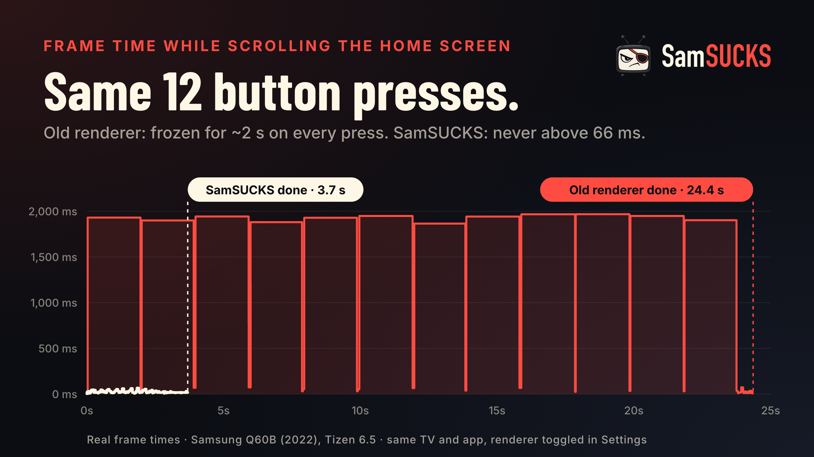

<p align="center">
  <picture>
    <source media="(prefers-color-scheme: light)" srcset="assets/brand/lockup-horizontal-dark-1920x640.png">
    
  </picture>
</p>

<p align="center">
  <b>A fast, good-looking player for your Plex library on Samsung TVs.</b><br>
  Instant browsing, hardware playback, and the extras the official app is missing.
</p>

<p align="center">
  <a href="https://github.com/DarkAngelGR/FlexPlex/releases/latest"></a>
  
  <a href="LICENSE"></a>
</p>

<p align="center">
  
</p>
<p align="center">
  
  
</p>

Orama (όραμα, Greek for "vision") replaces the official Plex app on Samsung smart TVs. The
official app takes up to a minute to open and lags on every key press; Orama opens in about a
second, scrolls smoothly, and plays almost everything straight through the TV's hardware
decoder, so your server barely has to work.

## Highlights

**Fast**
- Home in under a second, smooth scrolling everywhere, search results as you type.
- Direct play through Samsung's hardware decoder. Only what the TV really can't play is converted,
  and the player tells you exactly what's happening: *Direct Play*, *Direct Stream* or *Transcoding*.

**Made for watching**
- Pick quality, audio and subtitles before you press play, or make Greek or English subtitles
  the default for everything.
- Skip intro and credits, subtitle timing and size, up next with your languages kept, and
  each show remembers the audio and subtitle languages you picked for it.
- Audio the TV can't play (like DTS) is swapped for another track in the same language
  when the file has one, so nothing needs converting.
- Anime starts in Japanese with Greek (else English) subtitles, the full dialogue track rather
  than "Signs & Songs", and translated signs show at the top of the screen.
- Movie and show pages with ratings (IMDb, Rotten Tomatoes, TMDB), cast with photos, trailers,
  the rest of a movie's collection, episode descriptions, theme music and a full "More info" page.
- Hold OK on a Continue Watching tile to remove it, mark it watched or clear its progress.

**Made for your server**
- Search beyond your library: find any movie or show and add it to your Plex Watchlist.
- With [watchlist-sync](#optional-companions), Watchlist adds reach Sonarr and Radarr in seconds,
  and a *Downloading* row shows their progress live.
- The home screen shows library scans as they happen and picks up new media by itself.
- Delete a movie or show from its page (server owner only). With watchlist-sync it's removed from
  Radarr or Sonarr too, so it won't download again.
- With watchlist-sync and Bazarr: search for more subtitles from the TV and pick one, and a
  *Coming up* row shows episodes airing this week.

**Made for the household**
- Plex Home profiles, with PINs and an optional "Who's watching?" at start.
- Updates from GitHub Releases, installed from the TV itself with the optional
  [Orama installer](installer/).

## Getting started

You need a Samsung smart TV (2020 or newer recommended; Tizen 5.5+) and a Plex Media Server.

### Option 1: install a release with Apps2Samsung (easiest)

1. Download `Orama-x.y.z.wgt` from the [latest release](https://github.com/DarkAngelGR/FlexPlex/releases/latest).
2. Install it with [Apps2Samsung](https://github.com/Apps2Samsung/Apps2Samsung) (Windows, macOS
   or Linux): turn on Developer Mode on the TV (see below), pick the TV in Apps2Samsung, and
   install your own `.wgt`.
3. Open Orama on the TV, go to **[plex.tv/link](https://plex.tv/link)** on your phone and type the
   code it shows, or scan the QR code.

### Option 2: build and install from source (macOS or Linux)

```sh
git clone https://github.com/DarkAngelGR/FlexPlex.git orama
cd orama
./scripts/setup.sh     # Samsung's command-line tools, finds the TV, creates a signing certificate
./scripts/deploy.sh    # builds, installs and opens Orama on the TV
```

`setup.sh` stops and explains what to do if Developer Mode isn't on yet, and picks up where it
left off when you run it again.

<details>
<summary><b>Turning on Developer Mode</b></summary>

1. Press **Home** on the remote and open **Apps**.
2. On the Apps screen, type **1 2 3 4 5**. No number keys? Use the on-screen keypad (**123**).
3. Switch **Developer mode** to **On** and enter the IP address of the computer (or server) that
   will install apps.
4. Choose **OK**, then restart the TV: hold **Power** until it turns off and on again.

The Apps screen shows **Develop mode** at the top when it's on.
</details>

<details>
<summary><b>Troubleshooting</b></summary>

| Problem | Fix |
| --- | --- |
| Typing 12345 does nothing | Make sure you're on the **Apps** screen, and type quickly. |
| The TV isn't found | Turn it on and check it's on the same network as your computer. |
| "Can't reach the TV" when installing | Developer Mode must point at the installing machine's IP. Re-enter it and restart the TV. |
| The app disappeared | Firmware updates can remove sideloaded apps; install it again. |
| The sign-in code expired | Press **OK** on the sign-in screen for a new one. |
</details>

## Optional companions

Orama works on its own. Two small services on your server add more:

- **[watchlist-sync](https://github.com/DarkAngelGR/watchlist-sync)** sends the Plex Watchlists of
  your household and friends to Sonarr and Radarr. Orama then syncs Watchlist adds instantly,
  shows download progress and upcoming episodes, lists the parts of a collection you don't have
  yet, searches Bazarr for subtitles, and removes deleted titles from Sonarr/Radarr.
- **[Orama installer](installer/)** keeps Orama up to date: when a new release is out, install it
  from **Settings › Updates** on the TV or from a web page on your phone.

Both run in Docker and are found automatically when they run on the same machine as Plex.

## Using Orama

| Remote | What it does |
| --- | --- |
| Arrows / OK | Move around / select |
| Hold OK on a home tile | Options: remove from Continue Watching, watched / unwatched |
| Play/Pause | Play whatever is focused; pause and resume |
| Back | Go back (while watching, the first press hides the controls) |
| ▲ while watching | Show the info bar: title, progress and how it's playing |
| ▼ while watching | Audio, subtitles and quality |
| ◀ ▶ while watching | Seek; hold to go faster |
| CH ▲ / CH ▼ while watching | Subtitles on or off |
| ▲ from the first row of a library | Sort (A–Z, recently added, release date, rating) |
| CH ▲ / CH ▼ in a library | Jump by letter |

Everything else lives in **Settings**: profiles, default quality, subtitle language and style,
audio formats your TV can play, force direct play, theme music, downloads and updates.

## Why it's fast

Samsung TVs only run web apps, but the web engine is quick if you treat it like a game engine:
every animation is a GPU transform or fade, lists recycle a fixed set of tiles, the focus ring
stays still while content slides under it, a held key never queues up work, and Plex resizes
every image to exactly the pixels on screen.

The biggest single win was replacing a full-screen CSS gradient, which took almost two seconds
to repaint on the TV's CPU, with a 2×2-pixel WebGL texture the GPU stretches for free:

<p align="center">
  
</p>

<details>
<summary><b>Measurements</b> (2022 Samsung Q60B, Tizen 6.5, measured by the original SamSUCKS author)</summary>

| | Official Plex app | Orama |
| --- | --- | --- |
| Opening the app | about a minute | about a second |
| Typing in search | every letter lags | instant |
| Scrolling | stutters | about 50 fps, 17 ms median frame |

| Background renderer | fps while navigating | worst frame |
| --- | --- | --- |
| Full-screen CSS `radial-gradient` | 11 | 1,928 ms |
| 2×2 2D canvas, stretched by CSS | 20 | 207 ms |
| 2×2 WebGL canvas, stretched by the compositor | 49–50 | 80 ms |

On a real 3,952-item library, 98.7% of titles play without any transcoding.
**Settings › Performance overlay** shows the frame rate on your own TV.
</details>

## For developers

<details>
<summary><b>Project layout</b></summary>

```
app/            the TV app (plain ES modules, no framework, no bundler)
  js/screens/   home, library, detail, player, search, settings, profiles…
  js/ui/        rows, grids, tiles, image loader, backdrop, theme music
  js/plex/      plex.tv sign-in, Plex Media Server, Discover, watchlist-sync, updates
  js/platform/  Tizen keys and device info, AVPlay / <video> player
installer/      the Orama installer (Docker)
scripts/        setup.sh, deploy.sh, make-logo.py
tools/          dev server, TV eval, network remote
```

The TV's browser (Chromium 69+ on Tizen 5.5+) runs ES modules natively; `deploy.sh` adds
`<link rel="modulepreload">` tags so every module loads in parallel.
</details>

<details>
<summary><b>Dev loop on the real TV</b></summary>

Chrome DevTools can't attach to a retail TV, so dev builds talk to a small server on your
computer. Put its `host:port` in `.env` as `DEV_HOST` (see `.env.example`), then:

```sh
node tools/devserver.mjs          # receives logs and perf samples from the TV (build/tv.log)
./scripts/deploy.sh --dev         # dev build: performance overlay, logging, remote control

tools/tvsend.sh keys=down,right,enter                             # press buttons
tools/tveval.sh 'document.title'                                  # run JS on the TV
tools/tveval.sh '__bench(["right","right","left","left"], 250)'   # frame stats while replaying keys
```

The dev server only accepts commands carrying the random secret in `build/dev-secret`, created
on first run and built into `--dev` builds.

The UI also runs in desktop Chrome: `./scripts/deploy.sh --build-only`, then serve `build/app/`
with any static server (it uses a `<video>` element instead of AVPlay there).
</details>

<details>
<summary><b>Plex server notes</b></summary>

- Plex Media Server 1.42+ returns `400` for `start.m3u8` unless
  `/video/:/transcode/universal/decision` was called for the same session first.
- `X-Plex-Platform=Tizen` selects the server's profile for the official app, which rejects these
  transcode requests, so Orama identifies itself as `Samsung`.
- Samsung TVs from 2018 on don't decode DTS themselves; Orama converts it unless
  **Settings › Audio formats** says your setup (e.g. a soundbar over eARC) can play it.
</details>

## Credits

Orama started as a fork of [SamSUCKS](https://github.com/rfaile313/samsucks) by rfaile313 and was
inspired by [plx-native](https://github.com/GLinnik21/plx-native), a native Plex client for LG TVs.
Font: [Outfit](https://fonts.google.com/specimen/Outfit) (SIL Open Font License). QR codes:
[qrcode-generator](https://github.com/kazuhikoarase/qrcode-generator) by Kazuhiko Arase (MIT).
Installs and updates use [Apps2Samsung](https://github.com/Apps2Samsung/Apps2Samsung).

## License

Orama is free software under the [GNU General Public License v3.0](LICENSE). It is a modified
version of SamSUCKS, copyright © 2026 rfaile313; changes copyright © 2026 Aggelos (DarkAngelGR).
You can use, study, change and share it; anything you distribute that's built on it must stay
open source under the same license.

Orama is an independent project, not made by, endorsed by or affiliated with Plex, Inc. or
Samsung. "Plex" is a trademark of Plex, Inc., used only to say which media server Orama works with.
